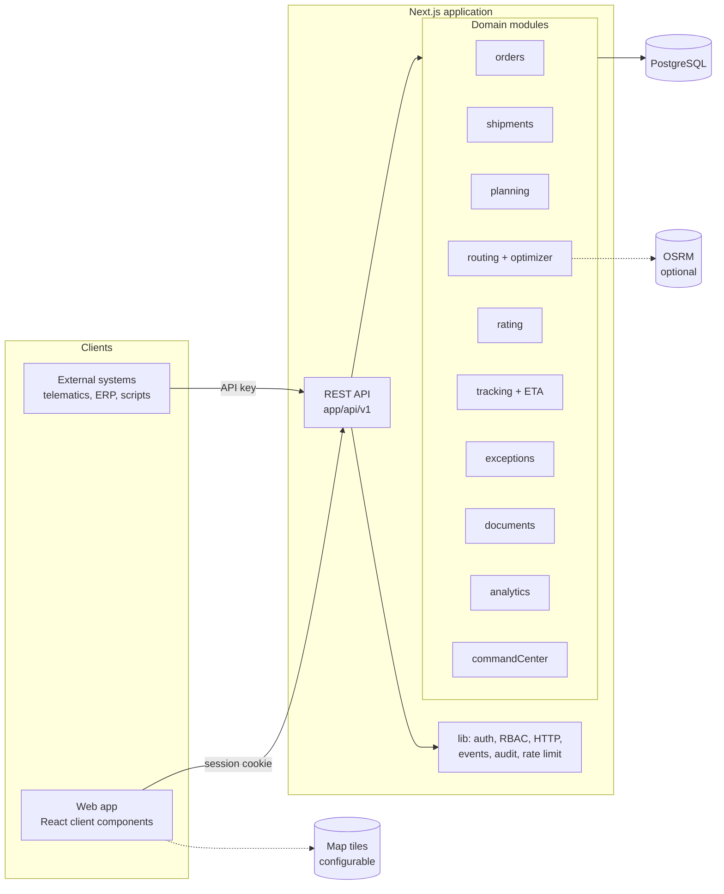
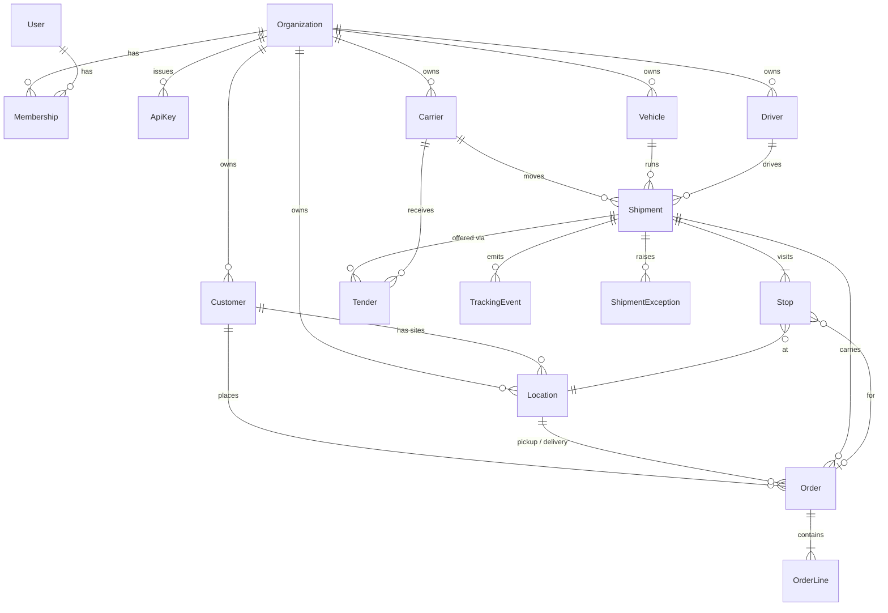

# Architecture

## Shape

A **modular monolith**: one deployable Next.js application, one PostgreSQL database.



The browser never talks to the database or to a module directly. Pages are client components that call `/api/v1`, the same API external developers use. That keeps the API honest: if the UI can do it, so can an integration.

## Repository structure

```
app/
  api/v1/            REST endpoints. Thin: authenticate, validate, call a module.
  api/health, ready  Liveness and readiness probes.
  (app)/             Signed-in pages (Command Center, orders, shipments, …).
  login, register    Public pages.
components/          Shell, map, shared UI.
lib/                 Cross-cutting infrastructure: auth, RBAC, HTTP wrapper,
                     events and audit, rate limiting, validation schemas.
modules/             Domain logic. No HTTP, no React.
  orders/  shipments/  planning/  routing/  rating/
  tracking/  exceptions/  documents/  analytics/  commandCenter/
prisma/              Schema and demo seed.
tests/               Unit and integration tests.
docs/                Product, testing, competitive and open-source notes; ADRs.
```

**Module rule:** `modules/*` may import `lib/*` and other modules' exported functions; nothing in `modules` or `lib` imports from `app`. Pure logic (optimizer, rating, ETA projection, geo) has no database access at all, which is what makes it unit-testable. A module that needs to become its own service later already has a function-call boundary to cut along.

## Domain model



Not drawn: `Document` (attached to a shipment, order or carrier by type + id), `DomainEvent`, `AuditLog`, `Counter`, `RateLimit`. The authoritative definition is [prisma/schema.prisma](prisma/schema.prisma).

### Lifecycles

```
Order:     OPEN → PLANNED → IN_TRANSIT → DELIVERED         (CANCELLED from OPEN)
Shipment:  DRAFT → PLANNED → TENDERED → ACCEPTED → DISPATCHED → IN_TRANSIT → DELIVERED
                     │           └── rejected ──► PLANNED (carrier cleared, exception raised)
                     └── own vehicle, no carrier ──► DISPATCHED
           any non-final state → CANCELLED (orders return to OPEN)
Stop:      PENDING → ARRIVED → COMPLETED
Exception: OPEN ⇄ INVESTIGATING → RESOLVED | IGNORED  (can be reopened)
```

Transitions are enforced in the module services, inside database transactions; an illegal transition returns `409 Conflict` with a message saying what to do instead.

## How the main pieces work

### Route optimization (`modules/routing/optimizer.ts`)

A pickup-and-delivery vehicle routing heuristic: cheapest insertion, then a relocate local search. Constraints: weight and volume capacity checked at every stop, pickup before delivery, and time windows (wait if early; late is either forbidden or penalised). Objectives: distance, time or cost. It is deterministic, which is why approving a proposed plan can safely re-run it. It is a heuristic and makes no claim of optimality.

Distances and durations come from a `RoutingProvider`:

| Provider | When | Notes |
|---|---|---|
| `haversine` (default) | Always available | Great-circle distance × a per-mode circuity factor, at a per-mode average speed. An estimate, labelled as such in the UI. |
| `osrm` | `ROUTING_PROVIDER=osrm` and `OSRM_URL` set | Road distances and geometry. Falls back to the estimate if the server is unreachable. Implemented but **not yet exercised against a live OSRM server**. |

### Rating (`modules/rating/rate.ts`)

Deterministic. Each charge is a line with a code, a label, the calculation in words, and an amount; the total is the sum of the lines. The breakdown is stored on the shipment.

### Tracking, ETA and delays (`modules/tracking/`)

`ingestTrackingEvent` is the single entry point for the UI, API keys and the simulator. In one transaction it stores the event, advances stop and shipment state, updates the position, re-projects arrival at every remaining stop, and raises or refreshes a delay exception when a projection passes a deadline by 15 minutes or more.

The ETA for the current leg is the *planned* leg duration scaled by the share of the leg still to cover, so it stays consistent with whichever routing provider planned the route.

### Exceptions (`modules/exceptions/`)

Exceptions are deduplicated by cause (one per late shipment, one per rejected tender), so a late truck pinging every minute refreshes one exception instead of creating hundreds. A resolved exception reopens only if the measured value worsens by 30 minutes or more.

### Events and audit

- `DomainEvent`: append-only business events (`ShipmentDispatched`, `TenderRejected`, …), readable at `GET /api/v1/events`. Written in the same transaction as the change they describe.
- `AuditLog`: who did what, with before/after values and a reason where one was given.
- `TrackingEvent`: append-only shipment history.

## Technology decisions

| Decision | Choice | Why |
|---|---|---|
| Architecture | Modular monolith | One thing to deploy and reason about. Boundaries are in the code, not the network. |
| Language | TypeScript end to end | One language, shared validation schemas and types between API and UI. |
| Framework | Next.js 14 (App Router) | API routes and UI in one deployable; runs on a Node server or serverless. |
| Database | PostgreSQL via Prisma | Relational integrity for a relational domain. |
| Geospatial | Latitude/longitude columns + in-app great-circle maths | Enough for the MVP. PostGIS is the planned next step for geofences and radius queries; the Docker image already ships it. |
| Optimization | In-house heuristic | See the trade-off below. |
| Background jobs | None yet | The MVP has no work that must run without a request. See "Known limits". |
| Message broker | None | Events are rows in Postgres. A broker is unnecessary at this scale. |
| Cache | None | Not needed yet. Rate-limit counters live in Postgres so serverless instances share them. |
| Auth | Signed session cookie (HS256 JWT) + hashed API keys | No external identity provider required to self-host. OIDC is on the roadmap. |
| Maps | Leaflet + configurable raster tiles (OpenStreetMap by default) | No dependence on a commercial mapping vendor. |
| File storage | Bytes in Postgres, 5 MB limit | Zero extra infrastructure. An S3-compatible backend is the planned replacement. |

**The significant trade-off.** The original brief preferred a Python/FastAPI backend with Google OR-Tools, Redis and a job queue. This project instead keeps a single TypeScript codebase. The cost is real: OR-Tools would produce better routes on large problems than the built-in heuristic, and there is no worker for scheduled or long-running tasks. The benefit is one deployable with one runtime. The optimizer sits behind a plain function interface, so a solver service can replace it without touching callers. See [ADR 0001](docs/adr/0001-typescript-modular-monolith.md).

## Known limits and future bottlenecks

Stated plainly so nobody discovers them in production:

- **No background worker.** Stale-tender detection runs when the Command Center or exception list is read. Nothing detects "vehicle stopped reporting". Scheduled work needs a worker (or cron-triggered endpoint).
- **Analytics are computed on read** from raw shipments. Fine for thousands of shipments; needs pre-aggregation or a read replica well before millions.
- **Tracking ingestion is one transaction per event.** High-frequency GPS (many vehicles × sub-minute pings) needs batching and a separate positions table, partitioned by time.
- **Optimizer cost grows roughly with the cube of stops per vehicle.** Requests are capped at 200 orders and 50 vehicles.
- **Documents in Postgres** inflate the database and backups.
- **One shipment = one mode, one leg sequence.** Multi-leg, multi-modal shipments need a `Leg` entity between shipment and stop. `TransportMode` already covers air, ocean, rail, courier, motorcycle and drone, and vehicles are typed by mode, so the model is not truck-shaped, but legs are not built.
- **Timestamps from the simulator run ahead of the wall clock.** Simulating seven hours of driving in a minute produces events stamped seven hours ahead. Analytics periods are therefore open-ended by default.
- **Tenant isolation is enforced in application code**, not by database row-level security.
